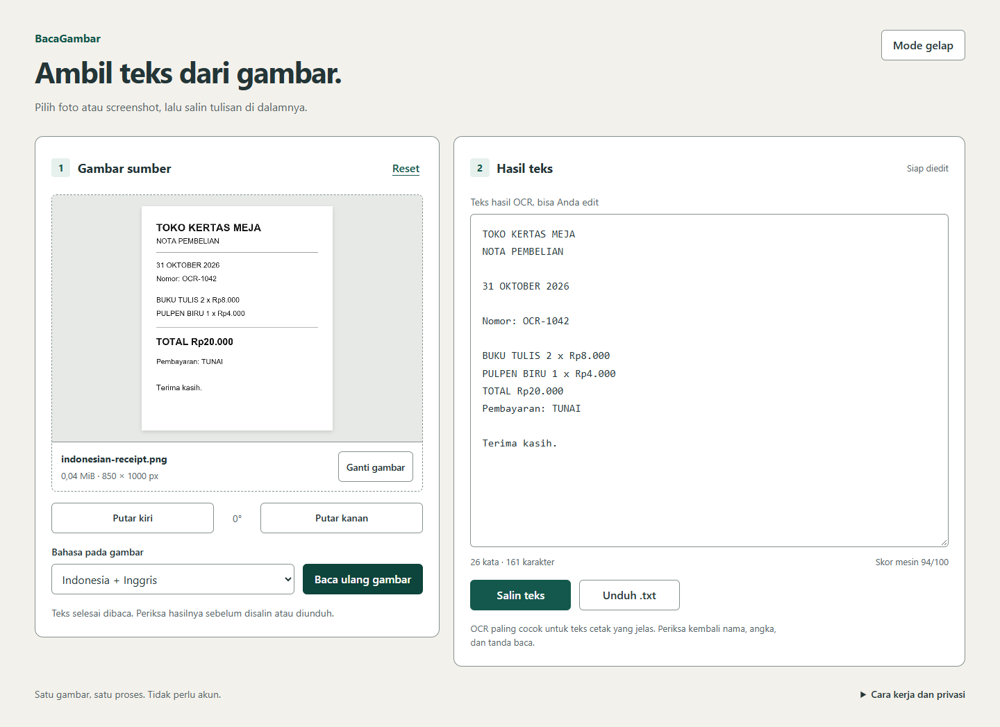
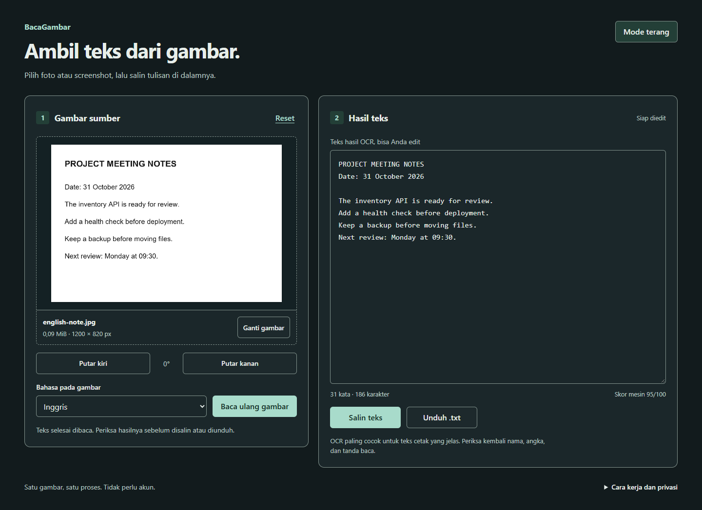
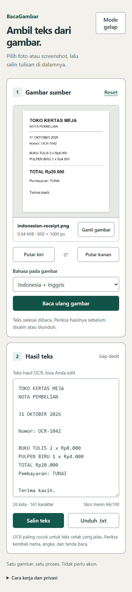

# BacaGambar

Ambil teks cetak dari foto atau screenshot langsung di browser, lalu perbaiki, salin, atau unduh hasilnya sebagai `.txt`. Pilih bahasa Indonesia, Inggris, atau keduanya. Aplikasi memakai Tesseract.js dan WebAssembly, tanpa akun dan tanpa server OCR.

[Buka aplikasi](https://zalamanga.github.io/baca-gambar-ocr/) · [Source GitHub](https://github.com/zalamanga/baca-gambar-ocr)

## Tampilan aplikasi

Gambar di bawah diambil dari aplikasi yang benar-benar membaca fixture sintetis. Teks pada editor adalah keluaran OCR sebelum pengeditan.



<details>
<summary>Lihat tema gelap dan tampilan ponsel</summary>





</details>

## Menjalankan secara lokal

Siapkan Node.js 22.12 atau lebih baru, npm, dan Python 3.9 atau lebih baru. Dari root proyek di PowerShell, jalankan:

```powershell
.\scripts\Start.ps1
```

Buka **http://127.0.0.1:8124**. Tekan Ctrl+C pada terminal untuk berhenti. [Skrip mulai](scripts/Start.ps1) memasang dependensi melalui `npm ci` bila diperlukan, membuat build, lalu menyajikannya hanya pada loopback. Instalasi pertama memerlukan koneksi internet. Cache npm, berkas sementara, dan cache Python berada di folder lokal proyek; pengaturan lingkungan proses dikembalikan saat skrip berakhir.

Untuk pengembangan frontend setelah dependensi tersedia:

```powershell
npm run dev
```

## Memakai aplikasi

1. Pilih satu gambar, tarik ke area gambar, atau tempel screenshot dengan Ctrl+V. Tombol **Coba contoh nota** memakai gambar sintetis yang disertakan proyek.
2. Pilih bahasa dan putar gambar bila tulisan miring. Klik **Ambil teks**.
3. Periksa teks, terutama nama, angka, dan tanda baca. Edit hasil sebelum memakai **Salin teks** atau **Unduh .txt**.

Tombol **Batalkan** menghentikan pekerjaan yang terlihat. Saat mesin baru pertama dimuat, pembersihan worker dapat menunggu unduhan yang sedang berlangsung. Memilih gambar lain atau memakai Reset juga membatalkan pekerjaan sebelumnya; hasil lama tidak mengganti pekerjaan baru.

| Masukan | Batas |
| --- | --- |
| Format | PNG, JPEG/JPG, WEBP statis |
| Ukuran berkas | Maksimal 10 MiB |
| Dimensi gambar | Maksimal 16 megapiksel dan 8.000 piksel per sisi |
| Gambar untuk OCR | Diperkecil bila perlu hingga 6 megapiksel dan 3.000 piksel per sisi |
| Bahasa | Indonesia, Inggris, atau gabungan keduanya |

PDF, HEIC, GIF, dan gambar animasi belum didukung. OCR paling cocok untuk teks cetak yang tajam dan tegak. Tulisan tangan, foto buram, tabel rumit, serta latar ramai dapat menghasilkan teks keliru. Skor mesin yang tampil bukan persentase akurasi dan tidak menggantikan pemeriksaan hasil.

## Privasi dan koneksi

Gambar dan teks diproses di tab browser. Aplikasi tidak mempunyai API unggah dan tidak menyimpan riwayat dokumen. Pilihan tema disimpan sebagai pengaturan browser. Worker, core, serta model bahasa dimuat dari origin situs yang sama; aplikasi tidak memakai CDN OCR saat berjalan. Server hosting tetap menerima permintaan berkas situs dan informasi HTTP biasa.

Kunjungan web pertama memerlukan unduhan aplikasi dan model bahasa. Cache browser dapat membantu pembacaan berikutnya, tetapi situs publik tidak menjamin akses offline karena proyek tidak memakai service worker. Setelah seluruh dependensi terpasang, build dan server lokal bisa dijalankan tanpa internet. Rincian sumber, versi, lisensi paket, dan URL aset tersedia di [catatan aset](docs/ASSETS.md).

Model bahasa diminta melalui `ocr/lang/eng.traineddata` dan `ocr/lang/ind.traineddata` pada origin yang sama, tanpa akhiran `.gz` untuk menghindari pengambilalihan URL arsip oleh pengelola unduhan. Ukuran model mentah Inggris 5.199.098 byte dan Indonesia 1.776.253 byte, total 6.975.351 byte jika keduanya dipilih. Build menyertakan sekitar 26,5 MiB aset OCR dan contoh; browser hanya memilih core serta bahasa yang diperlukan.

## Verifikasi

```powershell
$env:npm_config_cache = Join-Path (Get-Location) '.local\npm-cache'
$env:PLAYWRIGHT_BROWSERS_PATH = Join-Path (Get-Location) '.local\browsers'
npm test
npm run build
npx --no-install playwright install chromium
npm run test:browser
```

Instalasi Chromium hanya diperlukan untuk pengujian browser dan memerlukan unduhan pertama. Gunakan versi dependensi yang dipatok pada [package-lock.json](package-lock.json).

**Verifikasi lokal: PASS.** Sebanyak 41 tes unit dan 13 tes browser lulus. Suite browser menjalankan 10 proses OCR nyata pada tujuh fixture, mencakup PNG/JPEG/WEBP, transparansi, EXIF, rotasi, dan gambar kosong. Pengujian juga mencakup salin/unduh hasil edit, pembatalan, pergantian gambar, paste/drop, kegagalan worker, keyboard, serta dua tema. [Ringkasan browser](docs/evidence/windows-browser-summary.json) menyimpan hasil sebenarnya; satu kegagalan request worker sengaja diinjeksi untuk memeriksa recovery.

[Workflow Pages](.github/workflows/pages.yml) menjalankan instalasi terkunci, tes unit, build, dan tes browser dengan OCR nyata. Hanya build yang lolos seluruh tahap dapat diunggah untuk deployment dari branch utama. Artifact pemeriksaan menyimpan log, hasil browser, manifest aset, dan tangkapan layar dari run yang berhasil.

[Tinjauan UX](docs/UX-REVIEW.md) mencatat ruang lingkup pengujian tampilan, keyboard, kontras, dan keterbatasannya.

## Membaca kode

Mulai dari [panduan per file dan fungsi](docs/CODE-GUIDE.md), lalu lihat [fixture sintetis](tests/fixtures/manifest.json) untuk memahami cakupan dan batas pengujian. Tidak ada persentase akurasi atau waktu pembacaan yang dijanjikan; hasil bergantung pada gambar dan perangkat.
