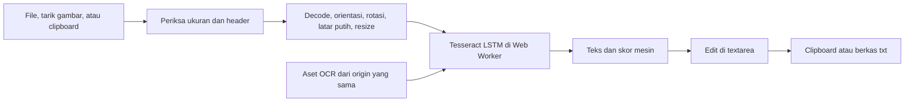

# Panduan kode per file dan fungsi

Aplikasi ini adalah frontend statis. Pemilihan gambar dan OCR berlangsung di browser; Python hanya menyajikan hasil build ketika dipakai secara lokal.

## Halaman dan pengendali UI

[index.html](../index.html) mendefinisikan area gambar, pengaturan bahasa/rotasi, progres, pesan kesalahan, editor hasil, ekspor, tema, dan penjelasan privasi. Elemen formulir dan tombol menggunakan elemen HTML asli. [styles.css](../src/styles.css) mengatur panel, keadaan fokus/disabled, tema terang dan gelap, serta susunan satu kolom pada layar kecil.

[main.js](../src/main.js) menghubungkan elemen halaman dengan modul gambar dan OCR. URL worker, core, dan model bahasa dibentuk dari `import.meta.env.BASE_URL`, sehingga tetap mengikuti subdirektori halaman.

| Fungsi | Peran |
| --- | --- |
| `message`, `clearError`, `errorMessage` | Memperbarui status dan kesalahan; kegagalan worker yang membutuhkan muat ulang tetap terlihat |
| `updateCounts`, `controls` | Menentukan hitungan teks serta tombol yang tersedia sesuai keadaan gambar dan pekerjaan |
| `releaseCanvas`, `resetResult` | Melepas buffer canvas atau mengosongkan hasil OCR lama |
| `cancelJob` | Menaikkan token versi, membatalkan pekerjaan engine, dan menutup progres UI |
| `selectFile` | Menyiapkan gambar baru; mengabaikan persiapan yang sudah kedaluwarsa dan mempertahankan gambar lama bila file baru gagal |
| `displayPreview` | Memasang canvas beserta nama, ukuran, dimensi proses, dan rotasi |
| `rotate` | Menyiapkan ulang dari file asli dengan kelipatan 90 derajat; hasil teks baru hanya dibuat setelah pembacaan ulang |
| `readImage` | Memulai OCR, menerjemahkan tahap progres, menerapkan hasil yang masih aktif, dan mempertahankan teks sebelumnya jika pembacaan gagal |
| `reset` | Membatalkan pekerjaan dan mengosongkan gambar serta teks dari tab |
| `applyTheme` | Menerapkan tema; penangan tombol menyimpan pilihan tema bila localStorage tersedia |

Token `version` mencegah callback dari file, rotasi, atau pekerjaan lama menimpa keadaan terbaru. Penangan event menyediakan pemilih berkas, drag/drop, paste gambar di luar kolom teks, salin dengan fallback seleksi manual, dan unduhan Blob UTF-8. `pagehide` membatalkan atau menutup engine sesuai apakah halaman masuk cache navigasi browser.

## Validasi dan persiapan gambar

Semua fungsi berikut berada di [image.js](../src/image.js). [IMAGE_LIMITS](../src/image.js#L1) memisahkan batas file yang diterima dari batas gambar yang dikirim ke OCR.

| Fungsi atau kelas | Peran |
| --- | --- |
| `ImageValidationError` | Kesalahan dengan kode stabil dan pesan yang dapat ditampilkan kepada pengguna |
| `assertSize`, `assertDimensions` | Membatasi berkas dan jumlah piksel sebelum decode; dipakai kembali setelah decode |
| `pngDimensions` | Memeriksa struktur chunk PNG, dimensi, data/akhir gambar, dan tanda APNG |
| `jpegDimensions` | Membaca marker frame JPEG untuk memperoleh dimensi tanpa mengalokasikan seluruh gambar |
| `webpDimensions` | Membaca chunk VP8/VP8L/VP8X, memeriksa batas chunk, dan menolak animasi |
| `inspectImageBytes` | Mengenali format dari isi biner, memeriksa ukuran/dimensi, dan menghasilkan metadata; ekstensi serta MIME file tidak dijadikan bukti format |
| `inspectImage` | Membaca byte dari File lalu memanggil pemeriksaan biner |
| `processingDimensions` | Menghitung ukuran setelah rotasi dengan rasio aspek tetap dan tanpa memperbesar gambar |
| `decode` | Memakai ImageBitmap berorientasi EXIF bila tersedia, lalu fallback elemen gambar; resource ditutup setelah dipakai |
| `prepareImage` | Mengisi latar putih, menggambar hasil decode dengan rotasi dan resize, lalu mengembalikan canvas untuk pratinjau dan OCR |

Pemeriksaan header membatasi alokasi berlebihan, tetapi bukan decoder gambar lengkap. Browser tetap harus berhasil membuka file. Transparansi diratakan di atas putih agar tulisan gelap tidak hilang saat OCR.

## Siklus worker OCR

[ocr.js](../src/ocr.js) membungkus Tesseract.js dalam `createOcrEngine`. Factory worker dapat diganti dalam tes unit agar keadaan pembatalan dan kegagalan dapat diperiksa secara deterministik; aplikasi normal tetap memakai Tesseract nyata.

| Bagian | Peran |
| --- | --- |
| `defaultWorkerFactory` | Mengimpor Tesseract.js saat dibutuhkan dan memanggil `createWorker` |
| `score`, `box`, `resultFrom` | Menormalisasi teks, skor, serta daftar kata/koordinat dari hasil engine; UI saat ini menampilkan teks dan skor agregat |
| `interrupt` | Menandai pembatalan, menolak promise pemanggil, dan membangunkan pekerjaan yang sedang menunggu |
| `blockInitialization` | Menetapkan keadaan wajib muat ulang ketika inisialisasi tidak memberi handle worker yang dapat dibersihkan |
| `run` | Mengurutkan inisialisasi, pengenalan, serta terminasi; memakai LSTM dan meminta teks beserta struktur kata |
| `recognize` | Memvalidasi bahasa, menggantikan pekerjaan aktif, dan memasukkan pekerjaan baru ke antrean |
| `cancel` | Membatalkan pekerjaan dan mengembalikan promise antrean pembersihan |
| `dispose` | Menolak pekerjaan baru lalu menjalankan pembatalan/pembersihan |

Antrean hanya membuka worker berikutnya sesudah pembersihan sebelumnya selesai. `Promise.race` membuat pemanggil dapat selesai saat dibatalkan meskipun promise internal pengenalan belum selesai. Pembatalan ketika `createWorker` belum mengembalikan handle tidak dapat langsung mematikan worker tersembunyi. Startup atau terminasi yang gagal membuat engine meminta muat ulang aplikasi; kegagalan pengenalan biasa tetap dapat dicoba ulang. Batas ini diperiksa terhadap sumber paket Tesseract.js 7.0.0 yang dipasang.

## Hitungan dan ekspor teks

[text.js](../src/text.js) berisi `textStats`, yang menghitung kata berdasarkan whitespace dan karakter berdasarkan Unicode code point, serta `downloadName`, yang mengambil nama dasar, menormalkan Unicode, membuang karakter nama file yang bermasalah, dan menambahkan awalan serta ekstensi `.txt`.

## Build dan penyajian lokal

| File | Peran |
| --- | --- |
| [package.json](../package.json) dan [package-lock.json](../package-lock.json) | Mematok dependensi dan mendefinisikan perintah dev, build, unit, serta browser |
| [vite.config.js](../vite.config.js) | Base relatif dan server loopback dengan port tetap 8124 |
| [prepare-assets.mjs](../scripts/prepare-assets.mjs) | Memeriksa versi terhadap lock, menyalin worker/core/contoh, mendekompresi model gzip dengan `node:zlib`, memeriksa tanda Wasm/gzip dan hash fixture, lalu mencatat hash sumber serta model mentah |
| [Start.ps1](../scripts/Start.ps1) | Memeriksa alat/dependensi, menjalankan `npm ci` bila perlu, build, dan server; mengembalikan environment proses dalam `finally` |
| [serve.py](../scripts/serve.py) | Hanya menyajikan build pada `127.0.0.1`; mendukung GET/HEAD, MIME Wasm, dan menolak traversal, dotfile, daftar direktori, serta metode tulis |

`safeOutput` pada penyiapan aset menolak lokasi di luar proyek dan jalur symlink. [Catatan aset](ASSETS.md) menjelaskan tiga varian LSTM, model bahasa best_int, sumber lisensi paket, dan perilaku jaringan. Folder aset hasil serta dependensi tidak dikomit; setiap build menyiapkannya ulang dari paket yang terkunci.

## Pengujian dan deployment

[image.test.js](../tests/image.test.js) menguji header format, batas ukuran/dimensi, animasi, file rusak, rotasi, dan hash fixture. [ocr.test.js](../tests/ocr.test.js) menguji antrean, pembatalan, hasil usang, error, dan pembersihan worker dengan factory uji. [text.test.js](../tests/text.test.js) memeriksa hitungan Unicode dan keamanan nama ekspor. Tes adapter bukan bukti akurasi OCR.

[Manifest fixture](../tests/fixtures/manifest.json) berisi teks sumber sintetis, fragmen yang wajib ditemukan, dan hash gambar tetap. [Generator fixture](../scripts/generate-fixtures.py) membutuhkan Pillow dan font yang tercatat bila gambar ingin dibuat ulang; generator tidak diperlukan untuk menjalankan aplikasi atau tes dengan fixture yang sudah disertakan.

[Suite browser](../tests/browser/ocr.spec.js) menjalankan 13 kasus dengan Tesseract nyata, termasuk 10 proses OCR yang selesai pada tujuh fixture. [Ringkasan Windows](evidence/windows-browser-summary.json) mencatat hasil, tiga screenshot, dan pemeriksaan jaringan. Satu request worker sengaja digagalkan pada kasus recovery; hasil teks tidak diganti dengan fixture atau mock. [Konfigurasi Playwright](../playwright.config.js) membatasi pengujian menjadi satu worker dan dapat memakai Microsoft Edge melalui BROWSER_CHANNEL=msedge.

[Workflow Pages](../.github/workflows/pages.yml) memakai Node.js 22 dengan patch terbaru, menginstal dependensi dari lock, menjalankan unit/build, memasang Chromium, lalu menjalankan suite browser. Log dan laporan dipertahankan sebagai artifact; screenshot hanya diunggah setelah tahap browser berhasil. Job deploy bergantung pada job verifikasi, berlaku pada branch utama di luar pull request, dan hanya menerbitkan hasil build. Izin menulis Pages serta OIDC dibatasi pada job deploy.

Workflow mengikuti pola proyek Retail Insights lokal. Versi action juga diperiksa pada rilis resmi: [checkout](https://github.com/actions/checkout/releases/tag/v7.0.1), [setup-node](https://github.com/actions/setup-node/releases/tag/v7.1.0), [setup-python](https://github.com/actions/setup-python/releases/tag/v7.1.0), [upload-artifact](https://github.com/actions/upload-artifact/releases/tag/v7.0.2), [upload-pages-artifact](https://github.com/actions/upload-pages-artifact/releases/tag/v5.0.0), [configure-pages](https://github.com/actions/configure-pages/releases/tag/v6.0.0), dan [deploy-pages](https://github.com/actions/deploy-pages/releases/tag/v5.0.1).
